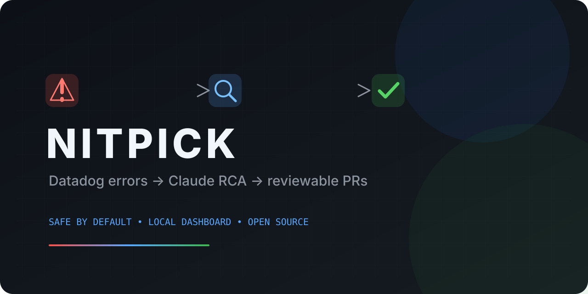
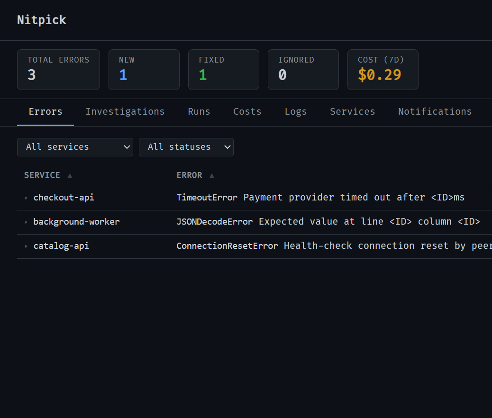

# Nitpick



[](https://github.com/FlyLikeAPenguin/nitpick/actions/workflows/ci.yml)
[](LICENSE)
[](https://www.python.org/)

Datadog errors → Claude root-cause analysis → GitHub issues and reviewable fix PRs.

Nitpick turns recurring production errors into deduplicated, actionable investigations. It runs locally, keeps costs visible, and never changes a live checkout during investigation.

> Nitpick is alpha software. Review every generated issue and PR before merging. Automatic fixes are disabled by default.



## Why Nitpick

Incident response often starts with the same manual loop: search logs, find the relevant code, write an RCA, file a ticket, and decide whether a fix is safe. Nitpick automates that loop while keeping the evidence, budget, and proposed change visible to the team.

- **Less duplicate work** — fingerprints group recurring errors before they consume investigation budget.
- **Actionable output** — each investigation can produce an RCA, issue, notification, and optional fix PR.
- **Local-first** — the dashboard and Markdown RCA sink run locally; provider credentials stay in environment variables.
- **Reviewable automation** — fixes happen in isolated git worktrees and are delivered as pull requests, never deployed directly.

## In production

Nitpick has run continuously against the live error logs of a voice AI company since 17 May 2026. These are that deployment's numbers as of 21 July 2026 — 65 days and 1,258 pipeline runs across 11 monitored services.

| | |
|---|---|
| Error log entries scanned | 40,529 |
| Unique errors identified | 1,437 |
| Distinct errors tracked after dedup | 381 |
| Investigations completed | 1,378 |
| Issues filed automatically | 1,030 |
| RCA documents written | 919 |
| Fix PRs opened / merged | 21 / 6 |
| Claude spend | $1,137.99 (~$0.81 per investigation) |

The first three rows are the point: fingerprinting collapses roughly 40,000 raw log entries into a few hundred distinct problems, and only those reach the agent. Without that step the same handful of recurring errors would consume the entire investigation budget every run.

Investigations triaged as 73 high, 286 medium, and 1,019 low severity, with 55% judged actionable and 4.4% judged auto-fixable.

Of the 21 fix PRs opened, 6 merged and 12 were closed unmerged. That ratio is the system working as designed rather than a shortfall: fixes arrive as pull requests precisely so a wrong one costs a review and nothing more. Automatic fixes remain off by default for the same reason.

## Safety model

Nitpick investigates errors with read-only access to configured code paths. Automatic fixes are **off by default**. To enable them, open the dashboard and turn on **Settings → Auto-fix & PR** for the relevant scope. A fix is still limited by a separate Claude budget, an isolated worktree, and a 250-line diff ceiling.

Before using Nitpick with production logs, review the data flow: matching log entries and configured source-code paths are supplied to Claude CLI, while provider APIs receive only the records needed to create the configured RCA, issue, or notification.

## Project status

Nitpick is an actively developed alpha project. The core pipeline, local dashboard, Datadog source, GitHub/Linear trackers, Markdown/Notion sinks, and console/Slack notifiers are implemented. See the [roadmap](docs/ROADMAP.md) for the direction of the project and [issues](https://github.com/FlyLikeAPenguin/nitpick/issues) for implementation-level work.

## Where Nitpick is going

The first release focuses on a dependable local Datadog + Claude workflow. The longer-term goal is a source-agnostic, reviewable incident layer that fits the tools and deployment model each team already has:

- **More sources** — Sentry, OpenTelemetry/OTLP, CloudWatch, webhooks, and fixture inputs.
- **More sinks** — Jira, richer RCA destinations, PagerDuty-style notifications, and generic webhooks.
- **More agent backends** — first-class Codex support alongside Claude CLI, with provider-neutral capability and cost controls.
- **More ways to deploy** — Docker/Compose, production-oriented systemd/launchd setups, and eventually stable self-hosted or hosted operation.

The [roadmap](docs/ROADMAP.md) explains what is shipped, what we are hardening now, and how these future tracks fit together.

## How it works

```
Error Source  →  Fingerprint + Dedup  →  Claude CLI Investigation
(Datadog)         (SQLite)                  │
                                            ├── RCA documentation (Markdown / Notion)
                                            ├── Issue filed (GitHub / Linear)
                                            ├── Fix attempt + PR (if <250 lines)
                                            └── Notification (Console / Slack)
```

Every run, the pipeline:

1. Fetches error-level logs from your configured error source
2. Normalises and fingerprints errors (strips UUIDs, timestamps, IPs, numeric IDs) to group duplicates
3. Deduplicates against a local SQLite cache — only new errors are investigated
4. Sends each new error to Claude CLI which reads the relevant source code, performs root cause analysis, and returns structured JSON
5. Creates an RCA document and files an issue via your configured providers
6. If Claude deems the fix feasible and under 250 lines, creates a git worktree, applies the fix, and opens a PR
7. Sends a notification with links to the RCA, issue, and PR

A local web dashboard at `localhost:8111` shows errors, investigations, runs, costs, and live logs.

## Providers

Nitpick uses a pluggable provider model. You choose an adapter for each role via `config.yml`:

| Role | Current | Roadmap | What it does |
|---|---|---|---|
| **Error source** | `datadog` | Sentry, OpenTelemetry/OTLP, CloudWatch, webhooks, fixtures | Fetches error logs |
| **Doc sink** | `markdown`, `notion` | Richer RCA destinations and templates | Creates RCA documentation |
| **Issue tracker** | `github`, `linear` | Jira and additional project adapters | Creates and manages issues |
| **Notifier** | `console`, `slack` | PagerDuty-style notifications and generic webhooks | Sends notifications |
| **Agent backend** | Claude CLI | Codex and a provider-neutral agent runner | Investigates errors and proposes actions |
| **Deployment** | Local process + dashboard | Docker/Compose and production-ready self-hosted operation | Runs the pipeline reliably |

With the defaults, you need only **Datadog + Claude CLI + `gh`** to get full value — no other SaaS accounts required. RCAs are written as local Markdown files and issues are filed as GitHub Issues.

## Prerequisites

- Python 3.12+
- [Claude CLI](https://docs.anthropic.com/en/docs/claude-code) installed and authenticated
- [`gh` CLI](https://cli.github.com/) authenticated (for PR creation and the default GitHub issue tracker)
- Datadog API + App keys for at least one site

## Quickstart

```bash
git clone https://github.com/FlyLikeAPenguin/nitpick.git && cd nitpick
python -m venv .venv && source .venv/bin/activate
pip install -e .

cp .env.example .env
# Edit .env — fill in your Datadog keys at minimum.
# Start with NITPICK_DRY_RUN=true while validating the setup.
```

Edit `config.yml` to add your services:

```yaml
providers:
  source:    { type: datadog }
  doc_sink:  { type: markdown }
  tracker:   { type: github }
  notifier:  { type: console }

services:
  my-api:
    datadog_query: "service:my-api status:error"
    regions: [us]
    code_paths:
      - repo: backend
        path: src/my_api

repos:
  backend: /path/to/your/backend/repo
```

Run:

```bash
# Single pipeline run
python -m src.main run

# Dry run (fetch + fingerprint only, no Claude)
NITPICK_DRY_RUN=true python -m src.main run

# Start dashboard
python -m src.main serve

# Preview the dashboard without Datadog or Claude credentials
python -m src.main demo
```

## Configuration

### Environment variables

Copy `.env.example` to `.env` and fill in credentials:

| Variable | Required | Description |
|---|---|---|
| `DD_US_API_KEY` / `DD_US_APP_KEY` | At least one site | Datadog US credentials |
| `DD_EU_API_KEY` / `DD_EU_APP_KEY` | — | Datadog EU credentials |
| `CLAUDE_BIN` | No | Path to Claude CLI binary (default: `claude`) |
| `CLAUDE_MAX_BUDGET` | No | Max USD per investigation (default: `2.00`) |
| `LINEAR_API_KEY` / `LINEAR_TEAM_ID` | Only for Linear tracker | Linear credentials |
| `NOTION_API_KEY` / `NOTION_DATABASE_ID` | Only for Notion doc sink | Notion credentials |
| `SLACK_WEBHOOK_URL` / `SLACK_CHANNEL_ID` | Only for Slack notifier | Slack credentials |
| `DASHBOARD_PORT` | No | Dashboard port (default: `8111`) |
| `NITPICK_INTERVAL` | No | Seconds between runs (default: `1800`) |
| `NITPICK_LOOKBACK` | No | How far back to search logs (default: `3600`) |
| `NITPICK_MAX_ERRORS_PER_RUN` | No | Max investigations per run (default: `10`) |
| `NITPICK_MAX_INVESTIGATIONS_PER_DAY` | No | Daily investigation cap (default: `50`) |
| `NITPICK_DRY_RUN` | No | Fetch and fingerprint only (default: `false`) |

### config.yml

```yaml
providers:
  source:    { type: datadog }    # Error log source
  doc_sink:  { type: markdown }   # Where RCA docs are written (markdown = local files)
  tracker:   { type: github }     # Where issues are filed (github = gh CLI)
  notifier:  { type: console }    # How you get notified (console = stdout)

services:
  my-api:
    datadog_query: "service:my-api status:error"
    regions: [us]                 # Datadog regions to search
    code_paths:                   # Where the source code lives
      - repo: backend
        path: src/my_api

repos:
  backend: /path/to/your/backend  # Local git clone

ignore_patterns:                  # Error messages matching these are skipped
  - "DeprecationWarning"
  - "health_check"
```

### Enabling optional providers

**Notion** (RCA documentation):
```yaml
providers:
  doc_sink: { type: notion }
```
Set `NOTION_API_KEY` and `NOTION_DATABASE_ID` in `.env`. Create a Notion database with properties: Title (title), Service (rich_text), Region (rich_text), Severity (rich_text), Fingerprint (rich_text).

**Linear** (issue tracking):
```yaml
providers:
  tracker: { type: linear }
```
Set `LINEAR_API_KEY` and `LINEAR_TEAM_ID` in `.env`. The team ID can be the short key (e.g. `ENG`) or UUID.

**Slack** (notifications):
```yaml
providers:
  notifier: { type: slack }
```
Set `SLACK_WEBHOOK_URL` and optionally `SLACK_CHANNEL_ID` in `.env`.

## Dashboard

Available at `http://localhost:8111` when running `python -m src.main serve`.

**Tabs:**
- **Errors** — All error groups with status, filterable by service/status. Click to expand details.
- **Investigations** — All Claude investigations with RCA, severity, fix status, cost, and links.
- **Runs** — Run history with stats (errors fetched, investigated, issues created, PRs, cost).
- **Costs** — Daily cost chart for the last 30 days.
- **Logs** — Live tail of the pipeline log.
- **Services** — Add/remove monitored services (edits `config.yml`).
- **Settings** — Toggle investigations, auto-fix PRs, and notifications globally or per-service. Auto-fix PRs start disabled.

## Known limitations

- Datadog is currently the only error-source provider.
- Claude CLI must be installed and authenticated separately.
- The dashboard is intentionally bound to `127.0.0.1`; it is not an authenticated multi-user web service.
- Generated fixes are proposals. Your normal review, CI, and deployment controls still apply.

## Development

```bash
python -m venv .venv
source .venv/bin/activate
pip install -e ".[dev]"
pytest
ruff check .
```

See [CONTRIBUTING.md](CONTRIBUTING.md) for the development workflow, issue expectations, and pull-request checklist. Please use [SECURITY.md](SECURITY.md) for vulnerability reports rather than opening a public issue.

## Scheduling

### macOS LaunchAgent

```bash
scripts/install.sh
```

This checks for `uv`, `claude` and `gh`, runs `uv sync`, creates `.env` and `config.yml` from the examples if they are missing, warns about any `repos:` path that does not exist, and loads two LaunchAgents for the current user: `com.<user>.nitpick` (hourly, on the hour) and `com.<user>.nitpick-dashboard` (always on). Re-running it replaces the jobs and leaves your `.env` and `config.yml` alone.

### cron

```
0 * * * * cd /path/to/nitpick && .venv/bin/python -m src.main run >> logs/cron.log 2>&1
```

### systemd

Create a timer unit for the pipeline and a service unit for the dashboard.

## Cost controls

- **Per-investigation budget**: `CLAUDE_MAX_BUDGET` caps each Claude CLI invocation (default $2)
- **Per-run limit**: `NITPICK_MAX_ERRORS_PER_RUN` caps investigations per pipeline run (default 10)
- **Daily limit**: `NITPICK_MAX_INVESTIGATIONS_PER_DAY` caps total investigations per day (default 50)
- **Deduplication**: Same root cause is only investigated once — fingerprinting ensures recurring errors don't waste tokens
- **Fix budget**: Fix attempts have a separate $3 budget cap

## Project structure

```
├── config.yml                  # Services + provider config
├── .env                        # Credentials (not committed)
├── src/
│   ├── main.py                 # CLI + pipeline orchestrator
│   ├── demo.py                 # Credential-free dashboard demo data
│   ├── config.py               # Env + YAML config loader
│   ├── models.py               # Dataclasses
│   ├── fingerprint.py          # Error normalisation + hashing
│   ├── cache.py                # SQLite dedup cache + dashboard queries
│   ├── investigator.py         # Claude CLI subprocess for investigation
│   ├── fixer.py                # Git worktree + Claude fix + PR creation
│   ├── dashboard.py            # Local HTTP server + API
│   └── providers/
│       ├── base.py             # Provider interfaces (Protocols)
│       ├── sources/datadog.py  # Datadog error source
│       ├── docsinks/markdown.py # Local Markdown RCA files
│       ├── docsinks/notion.py  # Notion RCA pages
│       ├── trackers/github.py  # GitHub Issues via gh CLI
│       ├── trackers/linear.py  # Linear issues via GraphQL
│       ├── notifiers/console.py # Console/log notifier
│       └── notifiers/slack.py  # Slack webhook notifier
├── static/
│   └── index.html              # Single-page dashboard UI
├── tests/                      # Fast unit and integration-boundary tests
├── .github/                    # CI, issue forms, and PR guidance
├── data/
│   └── error_cache.db          # SQLite database (created on first run)
└── logs/
    └── nitpick.log             # Pipeline logs
```

## License

MIT
